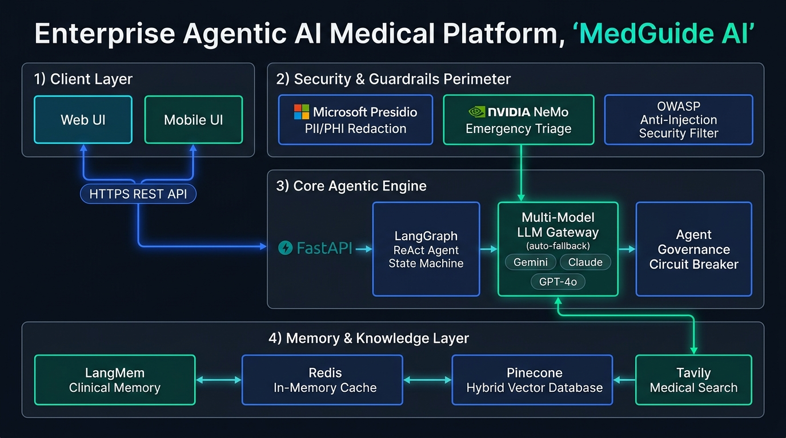

# 🩺 MedGuide AI — Multi-Model Medical Agent

[](https://www.python.org/)
[](https://fastapi.tiangolo.com)
[](https://www.docker.com/)
[](https://redis.io/)
[](https://langchain-ai.github.io/langgraph/)
[](LICENSE)

An enterprise-ready, educational medical agent featuring an **Autonomous LangGraph ReAct Agent**, **Unified LLM Gateway with Automatic Model Fallback**, **Dual Safety Guardrails (Microsoft Presidio & NVIDIA NeMo)**, **Agent Governance Toolkit**, **Long-Term Patient Memory (LangMem)**, and **Sub-Millisecond Redis Caching**.

---

## ✨ Key Features

- **🌐 Unified LLM Gateway & Fallback:** Seamlessly switch between **Google Gemini (2.5 / 2.0 Flash)**, **Anthropic Claude (3.5 Sonnet / Haiku)**, and **OpenAI (GPT-4.1 / GPT-4o)** via LiteLLM. Automatically triggers fallback models in milliseconds if an API fails or rate-limits.
- **🛡️ Dual Safety Perimeter:**
  - **Microsoft Presidio:** Real-time de-identification of PII/PHI (Names, Phone Numbers, MRN, SSN, Credit Cards).
  - **NVIDIA NeMo Guardrails:** Instant emergency triage interception (chest pain, stroke FAST, severe dyspnea), jailbreak defense, prescription & dosage blocking, and clinical disclaimer enforcement.
- **🧠 Agent Governance Toolkit:** Tool access control (RBAC), loop prevention budgets (max tool calls per turn), automated circuit breakers, and an emergency administrative kill-switch.
- **📝 Persistent Patient Memory (LangMem):** Cross-conversation extraction and recall of clinical facts (drug allergies, chronic conditions, current medications) backed by Redis and SQLite.
- **⚡ Redis Performance Acceleration:** Sub-millisecond response caching (reducing repetitive queries from ~2.5s to ~5ms) and sliding-window rate limiting with zero-crash in-memory fallback.
- **📊 Clinical Evaluation (DeepEval & RAGAS):** Comprehensive RAG Triad benchmarking (Faithfulness, Answer Relevancy, Hallucination, and Clinical Safety G-Eval) with an offline CLI runner (`eval.py`).
- **🔍 Hybrid Vector RAG:** Semantic vector retrieval using **Pinecone Serverless** paired with live fallback to **Tavily Search** for current clinical guidelines.
- **👁️ Multimodal & Voice Ready:** Dermatological image feature inspection (vision models) plus voice transcription (Whisper) and text-to-speech (TTS-1).

---

## 🚀 Quick Start

### Option A: Local Python Environment

```bash
# 1. Clone repository and install dependencies
pip install -r requirements.txt

# 2. Configure environment variables
copy .env.example .env
# Edit .env and supply your GEMINI_API_KEY, OPENAI_API_KEY, and PINECONE_API_KEY

# 3. Ingest reference medical knowledge base (run once)
python ingest.py --pdf data/medical_book.pdf

# 4. Start the FastAPI server
uvicorn app.main:app --reload --host 127.0.0.1 --port 8000
```
Open **http://127.0.0.1:8000** in your browser.

---

### Option B: Docker Compose (Recommended)

Run the full stack (**FastAPI App + Redis 7 + Redis Commander Admin**) with a single command:

```bash
# 1. Configure secrets
copy .env.example .env

# 2. Launch container stack
docker compose up --build -d

# 3. (Optional) Launch with Redis Commander UI on port 8081
docker compose --profile debug up --build -d
```

| Service | Endpoint | Description |
| :--- | :--- | :--- |
| **Web UI & Chatbot** | `http://localhost:8000` | Full interactive medical chat interface |
| **Swagger API Docs** | `http://localhost:8000/docs` | Interactive OpenAPI documentation |
| **System Health** | `http://localhost:8000/api/health` | Diagnostic status of all providers & services |
| **Redis Commander** | `http://localhost:8081` | Web admin UI to inspect cached responses & memory |

---

## 🏛️ System Design & Architecture

MedGuide AI is engineered as a production-grade Agentic AI platform built for clinical reliability, data security, high availability, and horizontal scalability.

### 1. Application & Agentic System Design

The diagram below illustrates the end-to-end runtime lifecycle of a patient query—from client ingestion, PII/PHI redaction, and multi-rail security inspection, through LangGraph state machine reasoning, multi-model gateway fallback, and persistent memory storage:



#### Architectural Layers:
1. **Client & API Gateway Tier:**
   - Interactive Web UI and Mobile Client communicate via secure HTTPS REST & SSE streaming APIs.
   - FastAPI gateway server handles authentication, sliding-window rate limiting, and 5ms sub-millisecond cached response dispatching.
2. **Security & Guardrails Perimeter (Defense-in-Depth):**
   - **Microsoft Presidio:** Automatic regex + NLP tokenization to de-identify PII/PHI (Names, Phone Numbers, MRN, SSN, Credit Cards) before LLM prompt assembly.
   - **NVIDIA NeMo Guardrails:** Millisecond-level emergency triage interception (chest pain, stroke symptoms, acute dyspnea), prescription blocking, and clinical disclaimer enforcement.
   - **OWASP Anti-Injection Security Filter:** Neutralizes direct system prompt overrides, prompt exfiltration attacks, and indirect prompt injections lurking inside external PDF/RAG chunks.
3. **Core Agentic Engine:**
   - **FastAPI Core:** Async request handling and lifecycle orchestration.
   - **LangGraph ReAct Agent:** Autonomous state machine orchestrating tool selection (`retrieve_knowledge` -> `search_medical_guidelines` -> `synthesize_answer`).
   - **Multi-Model LLM Gateway:** Unified abstraction layer with automatic zero-downtime failover across **Google Gemini 2.5 Flash**, **Anthropic Claude 3.5 Sonnet**, and **OpenAI GPT-4o**.
   - **Agent Governance & Circuit Breakers:** Hard tool execution budgets (max 5 calls/turn), role-based permissions, automated circuit breakers, and an administrative emergency kill-switch.
4. **Memory & Knowledge Layer:**
   - **LangMem Clinical Fact Memory:** Cross-session memory recalling patient allergies, chronic conditions, and past medications (guarded by an Anti-Poisoning Gate).
   - **Redis 7 In-Memory Cache:** Sub-millisecond response caching and session state management with automatic in-memory fallback.
   - **Pinecone Hybrid Vector Database:** Serverless cosine similarity search across indexed clinical medical encyclopedias.
   - **Tavily Medical Search:** Live medical research fallback for real-time epidemiological and guideline updates.

---

### 2. Cloud & Production DevOps Deployment Architecture (1M Users Scale)

To serve **1 Million Users (~50,000 DAU, 30-50 peak QPS)** with 99.99% uptime, MedGuide AI deploys across AWS using modern Infrastructure-as-Code (Terraform), container orchestration (Amazon EKS & Helm 3), and multi-AZ managed data stores:


#### Infrastructure & DevOps Components:
1. **Edge & Traffic Layer (HTTPS/TLS):**
   - **Amazon Route 53:** Global DNS routing with health-check failover.
   - **AWS CloudFront CDN & AWS WAF:** Edge caching of static frontend assets, DDoS mitigation, and OWASP Web Application Firewall rules.
   - **AWS Application Load Balancer (ALB Ingress):** SSL/TLS termination, HTTP/2 multiplexing, and 120s idle timeout for uninterrupted Server-Sent Events (SSE) token streaming.
2. **Kubernetes Compute Layer (Amazon EKS):**
   - Highly available EKS cluster spread across **3 Availability Zones (AZ-a, AZ-b, AZ-c)**.
   - **EKS Worker Node Groups:** Autoscaled managed node groups (`m5.xlarge` instances) running inside secure Private App Subnets.
   - **Horizontal Pod Autoscaler (HPA):** Dynamically scales application pods from **5 to 50 replicas** based on CPU/Memory thresholds (70% target utilization).
   - **Dockerized Multi-Stage Containers:** Lean Python 3.11-slim images running Gunicorn ASGI multi-workers with Uvicorn.
3. **Storage & In-Memory Caching Tier:**
   - **Amazon RDS PostgreSQL (Multi-AZ):** Active/Standby automated replication across private data subnets, integrated with **PgBouncer** connection pooling for high-concurrency patient fact storage.
   - **Amazon ElastiCache for Redis:** Multi-node cluster with in-transit TLS encryption for sub-millisecond response caching and distributed rate limiting.
4. **CI/CD & Infrastructure as Code (IaC) Pipeline:**
   - **Terraform:** Complete declarative IaC managing VPC, Subnets, Security Groups, EKS, RDS, ElastiCache, ECR, and IAM Roles for Service Accounts (IRSA).
   - **GitHub Actions CI/CD:** Automated pipeline triggered on pull requests and commits to `main`—running unit tests, Aqua Trivy container security scans, building and pushing images to **Amazon ECR**, and executing zero-downtime rolling upgrades via **Helm 3 Charts**.
5. **Observability & Operations:**
   - Structured JSON audit logging exported to **Amazon CloudWatch**, with **Prometheus & Grafana** metrics dashboards and AWS IAM Least-Privilege access management.

---

## 📚 Documentation Hub

Detailed technical guides and operational documentation are available in the [`docs/`](docs/README.md) directory:

| Guide | Description |
| :--- | :--- |
| [**📖 Documentation Hub**](docs/README.md) | Central navigation hub and quick links for all technical guides |
| [**🏛️ System Architecture**](docs/ARCHITECTURE.md) | In-depth LangGraph state machine, data flows, and Mermaid diagrams |
| [**📡 API Reference**](docs/API_REFERENCE.md) | Comprehensive REST API specification, JSON schemas, and `curl` examples |
| [**🛡️ Guardrails & Safety**](docs/GUARDRAILS_AND_SAFETY.md) | Microsoft Presidio PII masks, NeMo emergency triage, and HIPAA compliance |
| [**🌐 LLM Gateway & Fallback**](docs/LLM_GATEWAY.md) | Multi-provider routing, zero-downtime failover, and model chain configuration |
| [**🧠 Governance, Memory & Redis**](docs/GOVERNANCE_MEMORY_REDIS.md) | Agent Governance Toolkit (RBAC, kill-switch), LangMem, and Redis caching |
| [**📊 Evaluation & Benchmarks**](docs/EVALUATION_AND_BENCHMARKS.md) | DeepEval & Ragas evaluation suite, 10 Golden Cases, and LangSmith tracing |
| [**🐳 Deployment & Docker**](docs/DEPLOYMENT_AND_DOCKER.md) | Production Dockerfile, Compose orchestration, and security checklist |
| [**🛡️ Enterprise AI Security**](docs/AI_SECURITY.md) | OWASP Top 10 for LLMs, Anti-Poisoning Gate, Indirect Injections, and Exfiltration |
| [**🚀 1M Users DevOps Runbook**](docs/UBUNTU_PRODUCTION_DEPLOYMENT.md) | Step-by-step Ubuntu setup for Terraform, AWS EKS, Helm 3, RDS, and CI/CD |
| [**💻 Local K8s Development**](docs/LOCAL_K8S_KIND_DEPLOYMENT.md) | Local Kubernetes testing with Kind, Helm, Ingress, and HPA without AWS costs |
| [**📊 Monitoring & Alerting**](docs/MONITORING_PROMETHEUS_GRAFANA.md) | Prometheus metrics, Grafana dashboards, Alertmanager rules, and AI telemetry |
| [**🔄 Disaster Recovery Runbook**](docs/DISASTER_RECOVERY_AND_RUNBOOK.md) | Multi-Region failover, RDS PITR, Canary rollouts (Argo), and Sev-1/2 playbooks |
| [**💰 Cloud FinOps & Optimization**](docs/COST_AND_FINOPS_OPTIMIZATION.md) | 66% AWS cost savings via Karpenter, Graviton3, Spot Instances, and Prompt Caching |

---

## 📡 Core API Endpoints

| Method | Endpoint | Description |
| :--- | :--- | :--- |
| `GET` | `/api/health` | Comprehensive health check and active provider status |
| `POST` | `/api/chat` | Main clinical chat endpoint (RAG + Guardrails + Memory + AI Security) |
| `GET` | `/api/security/status` | Live Enterprise AI Security status and OWASP Top 10 matrix |
| `GET` | `/api/gateway` | Inspect current LLM Gateway fallback sequence |
| `GET` | `/api/guardrails` | Live status of Presidio PII and NeMo guardrails |
| `GET` | `/api/governance/status`| Live governance metrics, tool budgets, and circuit breaker |
| `POST` | `/api/governance/killswitch`| Freeze/resume all agent tool invocations |
| `GET` | `/api/memory` | Retrieve long-term patient profile facts (LangMem) |
| `GET` | `/api/redis/status` | Inspect Redis connection status and cache metrics |
| `POST` | `/api/eval/run` | Trigger on-demand DeepEval and Ragas evaluation run |
| `GET` | `/api/audit-logs` | Retrieve structured audit events with filtering |
| `POST` | `/api/transcribe` | Audio speech-to-text transcription via Whisper |
| `POST` | `/api/speak` | Text-to-speech audio synthesis via TTS-1 |

---

## 🧪 Clinical Benchmarking CLI (`eval.py`)

Run automated clinical benchmark evaluations against the golden test suite:

```bash
# Run evaluation across both DeepEval and RAGAS:
python eval.py

# Benchmark a specific foundation model:
python eval.py --model gemini/gemini-2.5-flash
python eval.py --model claude-3-5-sonnet-20241022

# Display latest evaluation scorecard:
python eval.py --latest
```

---

## 📁 Repository Structure

```
Medical-Agentic-Chatbot/
├── .github/workflows/
│   └── deploy.yml          # GitHub Actions CI/CD (Tests -> Trivy -> ECR -> EKS Helm)
├── app/
│   ├── agent.py            # LangGraph ReAct Agent (Retrieve -> Route -> Answer)
│   ├── audit.py            # HIPAA-compliant JSONL & RDS PostgreSQL audit logger
│   ├── config.py           # Pydantic environment configuration
│   ├── db.py               # Enterprise Dual-Driver Connection Pool (RDS Postgres + SQLite)
│   ├── evaluation.py       # DeepEval & Ragas benchmark engine
│   ├── governance.py       # Agent Governance Toolkit (RBAC, budgets, kill-switch)
│   ├── guardrails.py       # Presidio PII masking & NeMo Guardrails
│   ├── knowledge.py        # Pinecone vector retrieval & embeddings
│   ├── llm.py              # LLM Gateway with automatic multi-provider fallback
│   ├── main.py             # FastAPI REST server & streaming endpoints
│   ├── memory.py           # LangMem long-term patient clinical memory
│   ├── redis_client.py     # Redis caching layer with in-memory fallback
│   └── security.py         # Enterprise AI Security Engine (OWASP Top 10 for LLMs)
├── assets/                 # Architecture diagrams and design assets
│   ├── system_architecture.png       # Application & Agentic System Design
│   └── deployment_architecture.png   # AWS Cloud & 1M Scale DevOps Infrastructure
├── data/
│   └── medical_book.pdf    # Clinical reference encyclopedia PDF
├── docs/                   # Comprehensive technical documentation hub
│   ├── README.md           # Documentation index
│   ├── ARCHITECTURE.md     # In-depth system design & Mermaid state machine
│   ├── API_REFERENCE.md    # Full REST API specifications & curl examples
│   ├── AI_SECURITY.md      # Enterprise AI Security & OWASP mitigations
│   ├── GUARDRAILS_AND_SAFETY.md
│   ├── LLM_GATEWAY.md
│   ├── GOVERNANCE_MEMORY_REDIS.md
│   ├── EVALUATION_AND_BENCHMARKS.md
│   ├── DEPLOYMENT_AND_DOCKER.md
│   ├── INGESTION_AND_KNOWLEDGE_BASE.md
│   ├── UBUNTU_PRODUCTION_DEPLOYMENT.md # 1M Users Ubuntu Runbook (EKS, Terraform, Helm)
│   ├── LOCAL_K8S_KIND_DEPLOYMENT.md    # Local Kubernetes testing with Kind & Helm
│   ├── MONITORING_PROMETHEUS_GRAFANA.md # Prometheus, Grafana & Alertmanager setup
│   ├── DISASTER_RECOVERY_AND_RUNBOOK.md # High Availability, PITR & Sev-1/2 playbooks
│   └── COST_AND_FINOPS_OPTIMIZATION.md  # FinOps guide (Karpenter, Spot, Graviton)
├── helm/medguide/          # Production Helm 3 chart templates & values
├── k8s/                    # Kubernetes manifests (Namespace, Deployment, HPA, Ingress)
├── terraform/              # Infrastructure as Code (VPC, EKS, RDS, ElastiCache, ECR)
├── static/                 # Frontend CSS and JavaScript
├── templates/              # Chatbot web interface (HTML)
├── Dockerfile              # Multi-stage production container build
├── docker-compose.yml      # Orchestration (FastAPI + Redis 7 + Admin UI)
├── gunicorn_conf.py        # Production ASGI multi-worker process manager
├── eval.py                 # CLI benchmark runner
├── ingest.py               # PDF knowledge base indexing script
└── requirements.txt        # Python dependencies
```

---

## ⚠️ Clinical Disclaimer & Educational Notice

> **IMPORTANT:** MedGuide AI is designed strictly for **educational, triage demonstration, and research purposes**. It is **not** a certified medical diagnostic device and does **not** provide formal medical diagnoses, prescription drug dosages, or clinical treatment plans.
>
> In the event of a medical emergency, acute chest pain, stroke symptoms, severe breathing difficulty, or suicidal ideation, immediately call your local emergency services (**911** in the US/Canada, **112** in Europe/India) or proceed to the nearest emergency department.

---

## 📄 License

This project is licensed under the Apache License 2.0. See the [LICENSE](LICENSE) file for details.
