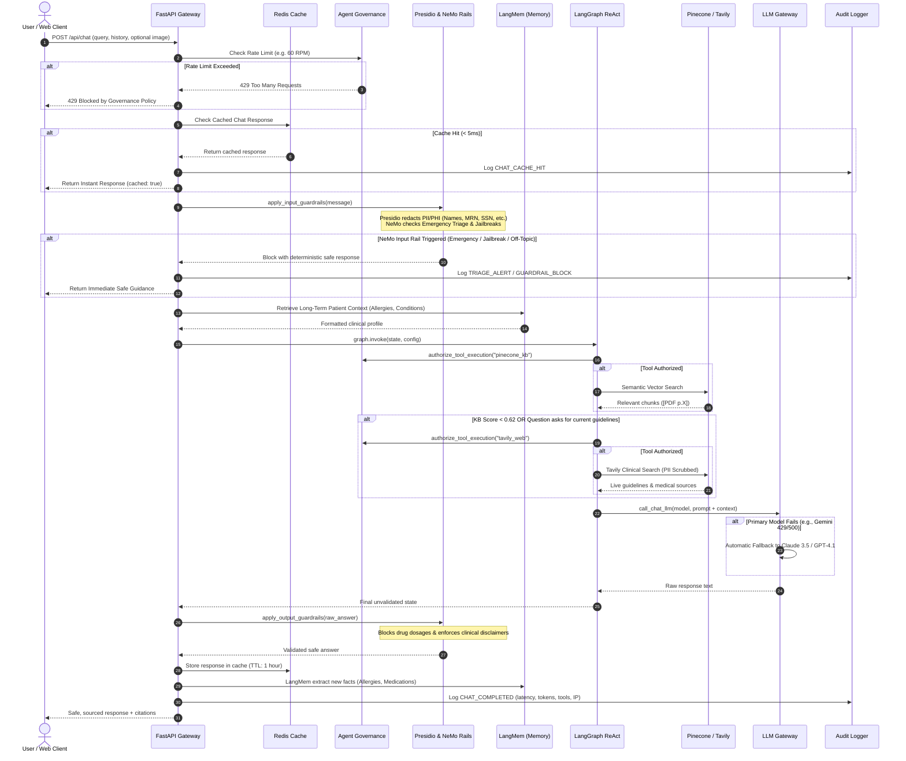
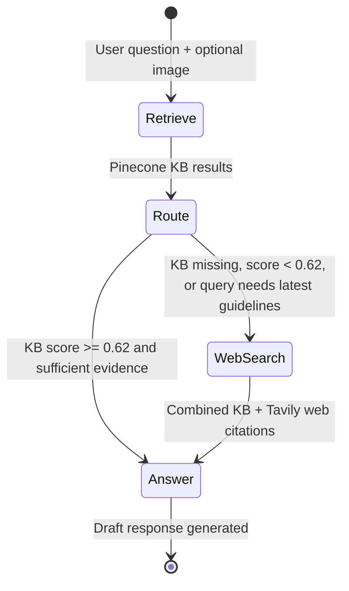

# MedGuide AI — System Architecture 🏛️

This document details the architectural principles, data flow, state machine mechanics, and component interactions that power **MedGuide AI**.

---

## 1. Architectural Philosophy

MedGuide AI is engineered around four core tenets:
1. **Safety First (Defense-in-Depth):** Every user prompt passes through multiple independent safety checks before reaching an LLM, and every generated response is validated for disclaimers and prescription prohibition before reaching the user.
2. **Resilience & High Availability:** No single provider failure can bring down the application. The **LLM Gateway** automatically fails over across Google Gemini, Anthropic Claude, and OpenAI GPT. Redis caching provides graceful in-memory fallbacks when external cache servers are offline.
3. **Strict Educational Scoping:** The agent is constitutionally prevented from asserting medical diagnoses, prescribing medications or dosages, or acting as a licensed medical practitioner.
4. **Deep Observability & HIPAA Readiness:** All interactions, tool executions, latency benchmarks, and safety interventions are captured in a rotating JSON Lines audit trail, paired with LangSmith distributed execution tracing and DeepEval clinical benchmarking.

---

## 2. End-to-End Request-Response Flow



---

## 3. LangGraph ReAct State Machine

The core clinical reasoning engine is implemented using **LangGraph** (`app/agent.py`), structuring the decision-making process into an explicit Directed Acyclic Graph (DAG):



### State Definition (`TypedDict`)
```python
class State(TypedDict):
    question: str               # Sanitized patient query (PII masked)
    history: list               # Prior conversation turns (limited to last 10)
    image_description: str      # Vision LLM objective observations (if image attached)
    kb: list                    # Pinecone vector retrieval results with cosine scores
    web: list                   # Tavily clinical search results
    answer: str                 # LLM synthesized educational response
    route: str                  # Routing decision ('answer' vs 'web')
    model: str                  # Requested LLM (Gemini, Claude, GPT)
    patient_context: str        # Long-term memories injected from LangMem
```

### Dynamic Routing Logic
- **`retrieve` Node**: Executes Pinecone vector lookup with cosine similarity thresholding.
- **`route` Node**: Evaluates evidence quality. If top chunk score $< 0.62$, or the prompt includes temporal keywords (`"latest"`, `"current"`, `"2026"`, `"guidelines"`, `"new treatment"`), execution routes to `web_search`. Otherwise, routes directly to `answer`.
- **`web_search` Node**: Invokes Tavily search with clinical query sanitization and PII stripping.
- **`answer` Node**: Formulates a prompt combining the system constitution, patient long-term history, PDF excerpts, and web citations for final synthesis.

---

## 4. Multi-Layered Safety & Guardrails Architecture

The system implements a zero-trust safety boundary around the core LLM:

```
                  ┌───────────────────────────────────────────────┐
                  │                 USER QUERY                    │
                  └───────────────────────┬───────────────────────┘
                                          │
                        [ INPUT GUARDRAILS LAYER ]
                                          │
               ┌──────────────────────────┴──────────────────────────┐
               ▼                                                     ▼
    ┌──────────────────────┐                              ┌──────────────────────┐
    │  Microsoft Presidio  │                              │   NVIDIA NeMo Rails  │
    │  - PII Masking       │                              │  - Emergency Triage  │
    │  - PHI Protection    │                              │  - Jailbreak Guard   │
    │  - Redacts [PERSON]  │                              │  - Off-Topic Defense │
    └──────────┬───────────┘                              └──────────┬───────────┘
               │                                                     │
               └──────────────────────────┬──────────────────────────┘
                                          ▼
                         [ AGENT REASONING & TOOLS ]
                                          │
                        [ OUTPUT GUARDRAILS LAYER ]
                                          │
               ┌──────────────────────────┴──────────────────────────┐
               ▼                                                     ▼
    ┌──────────────────────┐                              ┌──────────────────────┐
    │ Prescription Blocker │                              │ Disclaimer Enforcer  │
    │ - Detects dosages    │                              │ - Injects mandatory  │
    │ - Replaces with safe │                              │   educational notice │
    │   clinical advice    │                              │   if model forgot it │
    └──────────┬───────────┘                              └──────────┬───────────┘
               │                                                     │
               └──────────────────────────┬──────────────────────────┘
                                          ▼
                  ┌───────────────────────────────────────────────┐
                  │                 SAFE RESPONSE                 │
                  └───────────────────────────────────────────────┘
```

1. **Microsoft Presidio Layer:**
   - Detects patient names, phone numbers, email addresses, Medical Record Numbers (MRN), Social Security Numbers (SSN), and credit card numbers.
   - Masks sensitive tokens (e.g. `bittu sharma` $\rightarrow$ `<PERSON>`, `9876543210` $\rightarrow$ `<PHONE_NUMBER>`).
   - Ensures no patient PII reaches third-party API providers or audit logs.

2. **NVIDIA NeMo Guardrails Layer:**
   - **Emergency Triage Rail:** Detects life-threatening symptoms (chest pain, stroke, severe respiratory distress, suicidal thoughts) and triggers immediate emergency intervention with numbers (911 / 112) without invoking LLMs.
   - **Jailbreak / Injection Rail:** Neutralizes adversarial prompt attacks (DAN, roleplay exploits, instruction override).
   - **Off-Topic Rail:** Gently deflects non-medical queries (coding, politics, entertainment) back to healthcare education.
   - **Prescription & Dosage Blocker:** Intercepts unverified medication dosage recommendations and substitutes with standard consultation advice.
   - **Disclaimer Enforcer:** Appends mandatory educational disclaimers to ensure compliance.

---

## 5. Unified LLM Gateway & Fallback Architecture

MedGuide AI communicates with LLM providers through an intelligent abstraction layer (`app/llm.py`) built on LiteLLM:

```
                           call_chat_llm(model="gemini/gemini-2.5-flash")
                                              │
                                              ▼
                             ┌─────────────────────────────────┐
                             │    Step 1: Check Primary Model  │
                             │       gemini/gemini-2.5-flash   │
                             └────────────────┬────────────────┘
                                              │
                                     (success)│ (error / 429 / 500)
                                     ┌────────┴────────┐
                                     ▼                 ▼
                               ┌───────────┐     ┌─────────────────────────────────┐
                               │  Return   │     │    Step 2: Fallback Model #1    │
                               │  Answer   │     │       claude-3-5-sonnet         │
                               └───────────┘     └────────────────┬────────────────┘
                                                                  │
                                                         (success)│ (error)
                                                         ┌────────┴────────┐
                                                         ▼                 ▼
                                                   ┌───────────┐     ┌─────────────────────────────────┐
                                                   │  Return   │     │    Step 3: Fallback Model #2    │
                                                   │  Answer   │     │       gpt-4.1-mini              │
                                                   └───────────┘     └────────────────┬────────────────┘
                                                                                      │
                                                                             (success)│ (all failed)
                                                                             ┌────────┴────────┐
                                                                             ▼                 ▼
                                                                       ┌───────────┐     ┌───────────┐
                                                                       │  Return   │     │ 502 Bad   │
                                                                       │  Answer   │     │ Gateway   │
                                                                       └───────────┘     └───────────┘
```

- **Zero-Downtime Resilience:** Automatically retries across different providers with exponential backoff.
- **Provider-Aware Key Checking:** Dynamically constructs available model lists based on active API keys in `.env`.
- **Latency & Gateway Auditing:** Each attempt, latency delta, and failover event is logged with full transparency.

---

## 6. Long-Term Patient Memory Architecture (LangMem)

MedGuide AI maintains continuous, cross-session clinical context using **LangMem** (`app/memory.py`):

```
       Conversation Turn (Question + Answer)
                        │
                        ▼
       ┌─────────────────────────────────┐
       │   LangMem Fact Extractor        │
       │   - Allergy detection           │
       │   - Chronic conditions          │
       │   - Medication list             │
       └────────────────┬────────────────┘
                        │
                        ▼
       ┌─────────────────────────────────┐
       │   Two-Tier Storage Engine       │
       │                                 │
       │   1. High-Speed Cache (Redis)   │
       │      medguide:memory:{user_id}  │
       │                                 │
       │   2. Persistent Store (SQLite)  │
       │      patient_long_term_memory   │
       └────────────────┬────────────────┘
                        │
                        ▼
       Inject into next turn's System Prompt:
       "Patient Profile: Allergic to Penicillin; Diagnosed with Type 2 Diabetes"
```

---

## 7. High-Performance Caching & Resilience (Redis)

```
                       Inbound Request
                              │
                              ▼
               ┌───────────────────────────────┐
               │    Redis Connection Active?   │
               └──────────────┬────────────────┘
                              │
                    ┌─────────┴─────────┐
                    │                   │
                 (Yes)                 (No)
                    ▼                   ▼
        ┌───────────────────────┐   ┌───────────────────────┐
        │   Redis 7 Container   │   │  Thread-Safe In-Mem   │
        │   - Response Cache    │   │  TTL Fallback Cache   │
        │   - Rate Limiting     │   │  (Zero crash guarantee│
        │   - LangMem Storage   │   │   on connection drop) │
        └───────────────────────┘   └───────────────────────┘
```

---

## 8. Clinical Evaluation & Benchmarking (DeepEval & Ragas)

MedGuide AI features an offline and runtime clinical evaluation harness (`app/evaluation.py` and `eval.py`):

```
              Golden Clinical Dataset (10 Benchmark Cases)
                                │
                                ▼
              ┌─────────────────────────────────┐
              │     MedGuide Agent Execution    │
              └────────────────┬────────────────┘
                               │
            ┌──────────────────┴──────────────────┐
            ▼                                     ▼
┌───────────────────────────────┐     ┌───────────────────────────────┐
│        DeepEval Suite         │     │          RAGAS Suite          │
│ - Faithfulness Metric         │     │ - Faithfulness Metric         │
│ - Answer Relevancy Metric     │     │ - Answer Relevance Metric     │
│ - Hallucination Metric        │     │ - Context Precision Metric    │
│ - Clinical Safety G-Eval      │     └───────────────────────────────┘
└───────────────┬───────────────┘                     │
                └──────────────────┬──────────────────┘
                                   ▼
                    Comprehensive Evaluation Report
                    logs/evaluation_report.json
```
