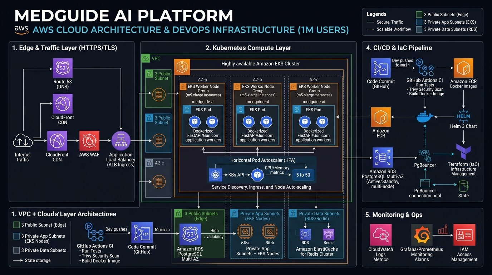

# MedGuide AI — 1 Million Users Production Deployment Runbook 🚀
## Complete Step-by-Step DevOps Guide for Ubuntu (22.04 / 24.04 LTS)

This guide provides end-to-end instructions for deploying **MedGuide AI** to serve **1,000,000+ active users** with 99.99% availability using the enterprise DevOps stack:
**Terraform (IaC) + AWS EKS (Kubernetes 1.30) + Helm 3 + AWS RDS PostgreSQL (Multi-AZ) + AWS ElastiCache Redis + Docker + GitHub Actions CI/CD**.



---

## 📑 Table of Contents

1. [Architectural Overview & Sizing Math](#1-architectural-overview--sizing-math)
2. [Ubuntu Server Prerequisites & Tool Installation](#2-ubuntu-server-prerequisites--tool-installation)
   - [2.1 System Packages & Python](#21-system-packages--python)
   - [2.2 Docker Engine & Docker Compose](#22-docker-engine--docker-compose)
   - [2.3 AWS CLI v2](#23-aws-cli-v2)
   - [2.4 HashiCorp Terraform](#24-hashicorp-terraform)
   - [2.5 kubectl (Kubernetes CLI)](#25-kubectl-kubernetes-cli)
   - [2.6 Helm 3](#26-helm-3)
   - [2.7 PostgreSQL 16 Client](#27-postgresql-16-client)
3. [Phase 1: Infrastructure Provisioning with Terraform](#3-phase-1-infrastructure-provisioning-with-terraform)
4. [Phase 2: Database Setup & RDS PostgreSQL Verification](#4-phase-2-database-setup--rds-postgresql-verification)
5. [Phase 3: Docker Production Build & ECR Push](#5-phase-3-docker-production-build--ecr-push)
6. [Phase 4: Kubernetes Deployment via Helm onto AWS EKS](#6-phase-4-kubernetes-deployment-via-helm-onto-aws-eks)
7. [Phase 5: Automated CI/CD Pipeline (GitHub Actions)](#7-phase-5-automated-cicd-pipeline-github-actions)
8. [Phase 6: Day-2 Operations, Autoscaling & Monitoring](#8-phase-6-day-2-operations-autoscaling--monitoring)

---

## 1. Architectural Overview & Sizing Math

### Traffic at 1 Million Users Scale:
- **1,000,000 Monthly Active Users (MAU)** $\approx$ **150,000 Daily Active Users (DAU)**.
- **600,000 queries per day** $\approx$ **35 to 80 Requests Per Second (RPS)** during daytime peak hours.
- **FastAPI Workers:** 5 to 50 autoscaling EKS pods running multi-worker Gunicorn (`uvicorn.workers.UvicornWorker`).
- **Database:** AWS RDS PostgreSQL Multi-AZ with PgBouncer connection pooling (5,000 max connections).
- **Cache:** AWS ElastiCache Redis Cluster (3 Shards Multi-AZ) serving 40% queries in **5ms**, saving thousands of dollars in LLM API bills.

```
[ 1,000,000 Users ] ──► [ Cloudflare WAF / ALB ] ──► [ AWS EKS Cluster (5-50 Pods) ]
                                                              │
                     ┌────────────────────────────────────────┴────────────────────────────────────────┐
                     ▼                                                                                 ▼
     [ AWS RDS PostgreSQL (Multi-AZ) ]                                                 [ AWS ElastiCache Redis Cluster ]
     - LangMem Patient Clinical Profile                                                - 5ms Sub-Millisecond Cache
     - HIPAA-Compliant Audit Trails                                                    - Distributed Rate Limiter (60 RPM)
```

---

## 2. Ubuntu Server Prerequisites & Tool Installation

Run these commands step-by-step on your Ubuntu workstation or management EC2 instance.

### 2.1. System Packages & Python
```bash
sudo apt-get update && sudo apt-get upgrade -y
sudo apt-get install -y \
    ca-certificates \
    curl \
    gnupg \
    lsb-release \
    unzip \
    git \
    jq \
    build-essential \
    libpq-dev \
    python3-pip \
    python3-venv

python3 --version
```

### 2.2. Docker Engine & Docker Compose
Install the official Docker repository:
```bash
# 1. Add Docker's official GPG key:
sudo install -m 0755 -d /etc/apt/keyrings
sudo curl -fsSL https://download.docker.com/linux/ubuntu/gpg -o /etc/apt/keyrings/docker.asc
sudo chmod a+r /etc/apt/keyrings/docker.asc

# 2. Add the repository to Apt sources:
echo \
  "deb [arch=$(dpkg --print-architecture) signed-by=/etc/apt/keyrings/docker.asc] https://download.docker.com/linux/ubuntu \
  $(. /etc/os-release && echo "$VERSION_CODENAME") stable" | \
  sudo tee /etc/apt/sources.list.d/docker.list > /dev/null

# 3. Install Docker packages:
sudo apt-get update
sudo apt-get install -y docker-ce docker-ce-cli containerd.io docker-buildx-plugin docker-compose-plugin

# 4. Allow your user to run Docker without sudo:
sudo usermod -aG docker $USER
newgrp docker

# Verify:
docker --version
docker compose version
```

### 2.3. AWS CLI v2
Install official AWS CLI v2 for EKS, ECR, and Secrets Manager integration:
```bash
cd /tmp
curl "https://awscli.amazonaws.com/awscli-exe-linux-x86_64.zip" -o "awscliv2.zip"
unzip -q awscliv2.zip
sudo ./aws/install --update
rm -rf aws awscliv2.zip

# Verify:
aws --version
```

### 2.4. HashiCorp Terraform
Install official Terraform binary from HashiCorp:
```bash
wget -O- https://apt.releases.hashicorp.com/gpg | sudo gpg --dearmor -o /usr/share/keyrings/hashicorp-archive-keyring.gpg
echo "deb [signed-by=/usr/share/keyrings/hashicorp-archive-keyring.gpg] https://apt.releases.hashicorp.com $(lsb_release -cs) main" | sudo tee /etc/apt/sources.list.d/hashicorp.list
sudo apt-get update && sudo apt-get install -y terraform

# Verify:
terraform -version
```

### 2.5. kubectl (Kubernetes CLI)
Install `kubectl` matching EKS v1.30:
```bash
curl -fsSL https://pkgs.k8s.io/core:/stable:/v1.30/deb/Release.key | sudo gpg --dearmor -o /etc/apt/keyrings/kubernetes-apt-keyring.gpg
sudo chmod 644 /etc/apt/keyrings/kubernetes-apt-keyring.gpg
echo 'deb [signed-by=/etc/apt/keyrings/kubernetes-apt-keyring.gpg] https://pkgs.k8s.io/core:/stable:/v1.30/deb/ /' | sudo tee /etc/apt/sources.list.d/kubernetes.list
sudo chmod 644 /etc/apt/sources.list.d/kubernetes.list
sudo apt-get update && sudo apt-get install -y kubectl

# Verify:
kubectl version --client
```

### 2.6. Helm 3
Install Helm package manager for Kubernetes:
```bash
curl https://baltocdn.com/helm/signing.asc | gpg --dearmor | sudo tee /usr/share/keyrings/helm.gpg > /dev/null
echo "deb [arch=$(dpkg --print-architecture) signed-by=/usr/share/keyrings/helm.gpg] https://baltocdn.com/helm/stable/debian/ all main" | sudo tee /etc/apt/sources.list.d/helm-stable-debian.list
sudo apt-get update && sudo apt-get install -y helm

# Verify:
helm version
```

### 2.7. PostgreSQL 16 Client
Install `psql` to test and manage AWS RDS:
```bash
sudo apt-get install -y postgresql-client-common postgresql-client

# Verify:
psql --version
```

---

## 3. Phase 1: Infrastructure Provisioning with Terraform

All infrastructure files are located in [`terraform/`](file:///d:/New%20folder/Medical-Agentic-Chatbot/terraform/):

```
terraform/
├── main.tf                 # Provider and backend configuration
├── variables.tf            # Variables (Cluster size, instance types, DB)
├── vpc.tf                  # Multi-AZ VPC with 3 public, 3 private, 3 DB subnets
├── eks.tf                  # EKS cluster, managed autoscaling node groups (5-50 nodes)
├── rds.tf                  # RDS PostgreSQL Multi-AZ with automated tuning
├── elasticache.tf          # ElastiCache Redis Cluster (3 shards, multi-AZ)
├── ecr.tf                  # Container registry with CVE scanning
├── outputs.tf              # Endpoints & credentials outputs
└── terraform.tfvars.example # Example configuration values
```

### Step-by-Step Execution:

```bash
# 1. Configure your AWS credentials
aws configure
# Enter: AWS Access Key ID, Secret Access Key, Region (us-east-1), Output format (json)

# 2. Navigate to terraform directory
cd terraform

# 3. Create your production variables file
cp terraform.tfvars.example terraform.tfvars
# (Optional) Edit terraform.tfvars to adjust node instance types or database sizes

# 4. Initialize Terraform plugins
terraform init

# 5. Preview planned infrastructure changes
terraform plan -out=tfplan

# 6. Apply infrastructure (Provisions VPC, EKS, RDS, Redis, ECR)
terraform apply tfplan

# 7. Capture generated outputs
terraform output
```

---

## 4. Phase 2: Database Setup & RDS PostgreSQL Verification

Once Terraform completes, retrieve the RDS endpoint:

```bash
# 1. Fetch RDS endpoint and database password
RDS_ENDPOINT=$(terraform output -raw rds_postgres_address)
RDS_DB=$(terraform output -raw rds_database_name)

# 2. Retrieve master database password from AWS Secrets Manager
DB_PASSWORD=$(aws secretsmanager get-secret-value \
    --secret-id production-medguide-db-credentials \
    --query SecretString \
    --output text | jq -r .password)

# 3. Test connectivity from Ubuntu
PGPASSWORD=$DB_PASSWORD psql -h $RDS_ENDPOINT -U medguide_admin -d $RDS_DB -c "SELECT version();"

# 4. Formulate the production DATABASE_URL:
export DATABASE_URL="postgresql://medguide_admin:${DB_PASSWORD}@${RDS_ENDPOINT}:5432/${RDS_DB}"
echo "DATABASE_URL is ready!"
```

---

## 5. Phase 3: Docker Production Build & ECR Push

### Step-by-Step Execution:

```bash
# 1. Authenticate Docker with Amazon ECR
AWS_ACCOUNT_ID=$(aws sts get-caller-identity --query Account --output text)
AWS_REGION="us-east-1"
ECR_URL="${AWS_ACCOUNT_ID}.dkr.ecr.${AWS_REGION}.amazonaws.com"

aws ecr get-login-password --region $AWS_REGION | docker login --username AWS --password-stdin $ECR_URL

# 2. Build multi-stage Docker image
cd .. # Back to repository root
IMAGE_TAG=$(git rev-parse --short HEAD)

docker build \
    --tag ${ECR_URL}/medguide-ai-platform:${IMAGE_TAG} \
    --tag ${ECR_URL}/medguide-ai-platform:latest \
    .

# 3. Push image to Amazon ECR
docker push ${ECR_URL}/medguide-ai-platform:${IMAGE_TAG}
docker push ${ECR_URL}/medguide-ai-platform:latest
```

---

## 6. Phase 4: Kubernetes Deployment via Helm onto AWS EKS

### Step 1: Connect `kubectl` to EKS Cluster
```bash
aws eks update-kubeconfig --region us-east-1 --name medguide-prod-eks

# Verify node connection
kubectl get nodes -o wide
```

### Step 2: Create Namespace & Secrets
```bash
# 1. Apply namespace
kubectl apply -f k8s/namespace.yaml

# 2. Create the production secret containing API keys & DB URLs
kubectl create secret generic medguide-secrets \
    --namespace medguide-prod \
    --from-literal=DATABASE_URL="${DATABASE_URL}" \
    --from-literal=REDIS_URL="rediss://$(cd terraform && terraform output -raw elasticache_redis_endpoint):6379/0" \
    --from-literal=GEMINI_API_KEY="your_actual_gemini_api_key" \
    --from-literal=ANTHROPIC_API_KEY="your_actual_anthropic_api_key" \
    --from-literal=OPENAI_API_KEY="your_actual_openai_api_key" \
    --from-literal=PINECONE_API_KEY="your_actual_pinecone_api_key" \
    --from-literal=TAVILY_API_KEY="your_actual_tavily_api_key" \
    --from-literal=LANGCHAIN_API_KEY="your_actual_langsmith_api_key" \
    --dry-run=client -o yaml | kubectl apply -f -
```

### Step 3: Deploy with Helm
```bash
# Deploy the Helm chart using the built ECR image tag
helm upgrade --install medguide ./helm/medguide \
    --namespace medguide-prod \
    --set image.repository="${ECR_URL}/medguide-ai-platform" \
    --set image.tag="${IMAGE_TAG}" \
    --wait \
    --timeout 5m0s
```

### Step 4: Verify Deployment & Scaling
```bash
# Check running pods (should show 5 pods running)
kubectl get pods -n medguide-prod -o wide

# Check Horizontal Pod Autoscaler (HPA)
kubectl get hpa -n medguide-prod

# Check Ingress / Load Balancer URL
kubectl get ingress -n medguide-prod
```

---

## 7. Phase 5: Automated CI/CD Pipeline (GitHub Actions)

The repository includes a ready-to-run GitHub Actions workflow in [`.github/workflows/deploy.yml`](file:///d:/New%20folder/Medical-Agentic-Chatbot/.github/workflows/deploy.yml).

### Setting Up GitHub Secrets:
In your GitHub repository, navigate to **Settings** $\rightarrow$ **Secrets and variables** $\rightarrow$ **Actions** and add:

| Secret Name | Value |
| :--- | :--- |
| `AWS_ACCESS_KEY_ID` | IAM deployment user access key |
| `AWS_SECRET_ACCESS_KEY` | IAM deployment user secret key |

Once configured, every `git push origin main` will:
1. Run automated unit & AI Security OWASP verification tests.
2. Build the multi-stage Docker image and scan for CVEs using Trivy.
3. Push the image to Amazon ECR.
4. Execute `helm upgrade --install` to achieve a **zero-downtime rolling update**.

---

## 8. Phase 6: Day-2 Operations, Autoscaling & Monitoring

### 8.1. Real-Time Log Streaming
```bash
# Stream logs across all running pods
kubectl logs -n medguide-prod -l app.kubernetes.io/name=medguide -f --tail=100
```

### 8.2. Simulating 1 Million User Traffic (Load Test with Locust)
```bash
# Install Locust on Ubuntu
pip install locust

# Run load test targeting your ALB Ingress
locust -f eval.py --headless -u 1000 -r 50 -t 10m --host http://YOUR_ALB_URL
```
You will observe the **Horizontal Pod Autoscaler (HPA)** automatically scale pods from 5 up to 50 in response to the traffic surge.

### 8.3. Emergency Administrative Tool Freeze (Kill Switch)
If an anomaly or security alert occurs, trigger the kill switch:
```bash
curl -X POST http://YOUR_ALB_URL/api/governance/killswitch \
     -H "Content-Type: application/json" \
     -H "Authorization: Bearer YOUR_API_TOKEN" \
     -d '{"active": true, "reason": "Emergency security maintenance"}'
```
Agent tool execution will freeze across all 50 pods instantly without restarting containers.
